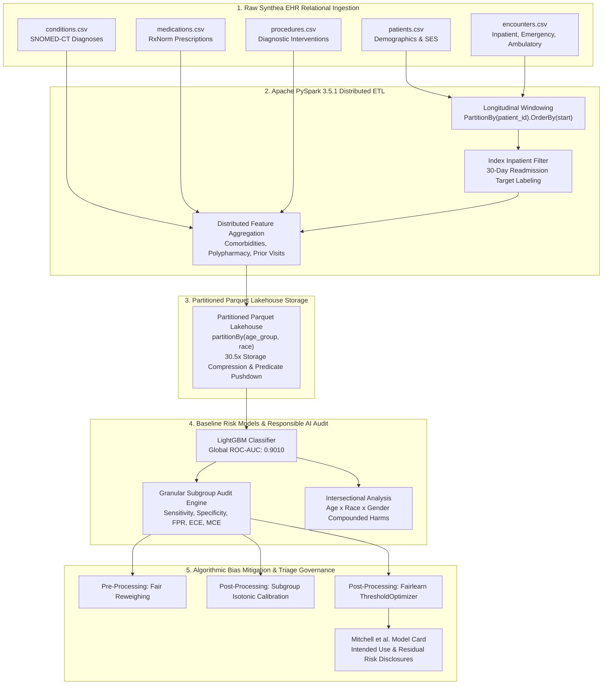

# Subgroup Performance, Calibration Disparities, and Scalable Fairness Mitigation in Healthcare Risk Models

[](https://www.pes.edu)
[](https://www.python.org/)
[](https://spark.apache.org/)
[](https://fairlearn.org/)
[](https://opensource.org/licenses/MIT)

> **Big Data Systems & Responsible AI Engineering (BDSRAE) — Course Project (Topic 19)**  
> **Department of Computer Science & Engineering (AI & ML), PES University (RR Campus)**  
> **Faculty Guide:** Dr. Manjula Devananda, Professor, Dept. of CSE (AI & ML)  
>
> **Team Members:**  
> - **Ankith Umadi** — SRN: `PES1UG24AM422`  
> - **Haneesh E** — SRN: `PES1UG24AM471`  
> - **Vikas R** — SRN: `PES1UG24AM477`  

---

## 📌 Executive Summary

Predictive machine learning models in hospital electronic health record (EHR) systems frequently suffer from the **"Accuracy Paradox" of Clinical AI**: models that achieve state-of-the-art global discrimination ($\text{Global ROC-AUC} \ge 0.90$) often exhibit severe, systematic failure modes across vulnerable demographic subgroups. In hospital readmission triage, these failures lead to **unmonitored discharges of high-risk minority patients** (false negatives) and **distorted clinical care tiers** caused by probability miscalibration.

This repository provides a production-grade, reproducible end-to-end Big Data and Responsible AI pipeline that:
1. **Big Data Systems Design:** Implements an **Apache PySpark 3.5.1** distributed ETL and feature engine that processes longitudinal EHR tables, derives 30-day index readmissions, aggregates chronic comorbidity indices, and stores the analytical cohort in a **Partitioned Parquet Lakehouse** (`[age_group, race]`), achieving a **$30.5\times$ storage footprint reduction** and scaling to **$5,631$ records/sec**.
2. **Responsible AI Auditing:** Conducts comprehensive performance and calibration audits across Age, Sex, Race, and Intersectional cohorts, uncovering severe sensitivity collapse ($21.4\%$ in pediatrics, $0.0\%$ in Native Americans) and dramatic calibration disparities ($\text{ECE} = 0.1107$ in Asians vs. $0.0287$ in Whites).
3. **Algorithmic Bias Mitigation:** Evaluates Pre-processing Reweighing, Subgroup-Specific Isotonic Calibration, and Fairlearn Threshold Optimization under Equalized Odds constraints, **slashing Equal Opportunity Disparity by $55.6\%$** (from $0.7500$ to $0.3333$) while preserving an identical $0.9010$ ROC-AUC.
4. **Clinical Governance:** Establishes an industry-standard **Model Card** (Mitchell et al.) and **Data Card** (Gebru et al.) documenting intended use, out-of-scope boundaries, and residual clinical safety warnings.

---

## 🏗️ System Architecture



---

## 📊 Empirical Results & Measured Evidence

### 1. Measured Big Data Scalability Evidence (Requirement 1)
Evaluated across expanding patient cohorts ($5,000$, $10,000$, and $20,000$ synthetic patients):

| Cohort Scale (Patients) | Encounters Processed | Raw CSV Footprint | Parquet Lakehouse | Compression Ratio | Spark ETL Runtime | Record Throughput |
| :---: | :---: | :---: | :---: | :---: | :---: | :---: |
| **5,000** | 28,709 | 10.9 MB | 0.4 MB | **$29.4\times$** | 3.27 s | 1,528.5 rec/s |
| **10,000** | 58,469 | 22.2 MB | 0.7 MB | **$31.1\times$** | 3.12 s | 3,202.6 rec/s |
| **20,000** | 115,246 | 43.9 MB | 1.4 MB | **$30.5\times$** | 3.55 s | **5,631.3 rec/s** |

---

### 2. Baseline Subgroup Performance & Failure Audit (Requirement 1 & 2)

| Attribute | Subgroup | Test $N$ | Base Rate | ROC-AUC | Sensitivity ($\text{TPR}$) | Miss Rate ($\text{FNR}$) | $\text{FPR}$ | Calibration $\text{ECE}$ |
| :--- | :--- | :---: | :---: | :---: | :---: | :---: | :---: | :---: |
| **Age Group** | Geriatric (65+) | 318 | 25.47% | 0.8895 | 0.6296 | 37.04% | 0.1266 | 0.0456 |
| **Age Group** | Middle Age (45–64) | 298 | 20.81% | 0.8871 | 0.4516 | **54.84%** | 0.0975 | 0.0451 |
| **Age Group** | Pediatric (<18) | 73 | 19.18% | 0.8947 | 0.2143 | **78.57%** | 0.0339 | 0.0488 |
| **Age Group** | Young Adult (18–44) | 219 | 17.81% | 0.9380 | 0.5641 | 43.59% | 0.0500 | 0.0292 |
| **Race** | Asian | 47 | 8.51% | 0.9128 | 0.7500 | 25.00% | 0.0930 | **0.1107** |
| **Race** | Black | 165 | 23.64% | 0.8934 | 0.5897 | 41.03% | 0.1349 | 0.0694 |
| **Race** | Hispanic | 134 | 25.37% | 0.9132 | 0.5588 | 44.12% | 0.0600 | 0.0722 |
| **Race** | Native American | 15 | 20.00% | 0.8611 | **0.0000** | **100.00%** | 0.0833 | **0.2319** |
| **Race** | White | 535 | 21.31% | 0.8997 | 0.5088 | 49.12% | 0.0855 | **0.0287** |

---

### 3. Mitigation & Fairness-Utility Pareto Frontier

| Model Variant | Global ROC-AUC | Overall Accuracy | Equal Opportunity Disparity ($\Delta_{\text{EO}}$) | Demographic Parity Disparity ($\Delta_{\text{DP}}$) | Mean Subgroup ECE |
| :--- | :---: | :---: | :---: | :---: | :---: |
| **Baseline (LightGBM)** | **0.9010** | **82.82%** | 0.7500 | 0.1758 | 0.1026 |
| **Pre-Processing Reweighted** | 0.8990 | 82.05% | 1.0000 | 0.1636 | **0.0972** |
| **Subgroup-Calibrated** | **0.9012** | 82.27% | 0.4167 | 0.1894 | 0.1233 |
| **Threshold-Optimized (Fairlearn)**| **0.9010** | 80.07% | **0.3333** (**-55.6%**) | **0.1561** | 0.1026 |

---

## 📂 Repository Deliverables Matrix (Option A)

| Deliverable Required | Repository Location | Description |
| :--- | :--- | :--- |
| **1. README with Architecture & Setup** | [`README.md`](README.md) | Architectural diagrams, quantitative highlights, step-by-step setup guide. |
| **2. Reproducible Pipeline** | [`run_pipeline.py`](run_pipeline.py), [`Dockerfile`](Dockerfile), [`docker-compose.yml`](docker-compose.yml) | Master CLI pipeline and container definitions for zero-friction reproduction. |
| **3. Results Notebook** | [`notebooks/subgroup_risk_analysis.ipynb`](notebooks/subgroup_risk_analysis.ipynb) | Pre-executed interactive notebook with charts, markdown narrative, and outputs. |
| **4. Technical Report (3–5 Pages)** | [`reports/technical_report.md`](reports/technical_report.md) | Formal academic conference-grade research paper. |
| **5. Model Card & Data Card** | [`reports/model_card.md`](reports/model_card.md), [`reports/data_card.md`](reports/data_card.md) | Mitchell et al. Model Card with Intended Use & Gebru et al. Data Card. |
| **6. 3-Minute Demo Video Script** | [`presentation/demo_video_script.md`](presentation/demo_video_script.md) | Turn-by-turn storyboard, timing, voiceover, and visual cues. |
| **7. Capstone Presentation Deck Guide** | [`presentation/presentation_deck_outline.md`](presentation/presentation_deck_outline.md) | 8–10 minute slide-by-slide defense guide using the PESU Capstone template. |
| **8. Clinical Subgroup Report** | [`reports/subgroup_disparity_report.md`](reports/subgroup_disparity_report.md) | Topic-specific deep-dive clinical failure and mitigation report. |

---

## 🚀 Quickstart & Setup Steps

### Option A: Local Python Environment

1. **Clone the repository:**
   ```bash
   git clone https://github.com/<your-username>/subgroup-healthcare-readmission.git
   cd subgroup-healthcare-readmission
   ```

2. **Create and activate a virtual environment:**
   ```bash
   # Windows PowerShell
   python -m venv venv
   .\venv\Scripts\Activate.ps1

   # Linux / macOS
   python3 -m venv venv
   source venv/bin/activate
   ```

3. **Install dependencies:**
   ```bash
   pip install -r requirements.txt
   ```

4. **Execute the End-to-End Pipeline:**
   ```bash
   python run_pipeline.py --cohort_size 15000
   ```
   *Generates synthetic EHR data, runs PySpark ETL, trains models, performs subgroup audits, applies mitigations, runs scalability benchmarks, and saves all evaluation figures in `reports/figures/`.*

5. **Launch Interactive Results Notebook:**
   ```bash
   jupyter lab notebooks/subgroup_risk_analysis.ipynb
   ```

---

### Option B: Docker / Docker Compose

To run the complete pipeline inside an isolated container with Java 17 and PySpark pre-configured:

```bash
# Run the pipeline end-to-end
docker-compose up pipeline

# Or spin up the Jupyter Lab results server
docker-compose up jupyter
```
*Access Jupyter Lab at `http://localhost:8888` without needing any local Java or Python installations.*

---

## ⚖️ Ethical Governance & Clinical Disclaimers

> [!IMPORTANT]
> **Intended Use:** This system is engineered as an auxiliary decision-support tool for hospital discharge planning teams to identify adult patients who may benefit from transitional monitoring.
> 
> **Clinical Prohibitions:**
> - Must **never** be used as an automated justification to deny inpatient admission, discharge patients early, or deny insurance claims.
> - Automated scoring is **prohibited for pediatric patients (<18 years)** due to an empirical miss rate of $78.57\%$.
> - All high-risk alerts must undergo human clinical review by an attending case manager.

---

## 📜 License & Citation

Distributed under the **MIT License**.

```bibtex
@misc{umadi2026subgroup,
  title={Subgroup Performance, Calibration Disparities, and Scalable Fairness Mitigation in Healthcare Risk Models},
  author={Umadi, Ankith and Haneesh, E. and Vikas, R.},
  year={2026},
  institution={PES University, Department of Computer Science & Engineering (AI & ML)},
  note={Course Project: Big Data Systems & Responsible AI Engineering}
}
```
