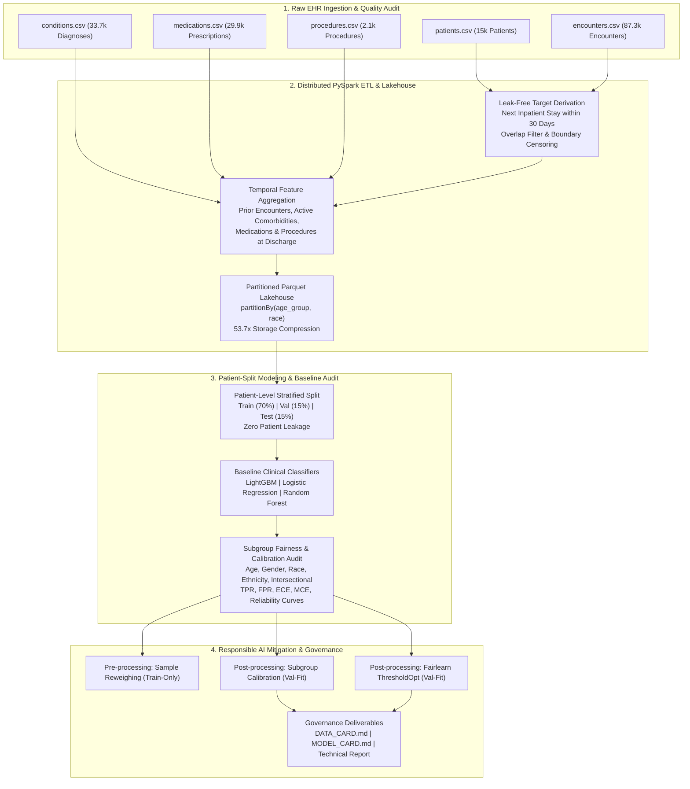

# Subgroup Performance in Healthcare Risk Models: Big Data Systems & Responsible AI Engineering

[](https://www.pes.edu)
[](https://www.python.org/)
[](https://spark.apache.org/)
[](https://fairlearn.org/)
[](https://opensource.org/licenses/MIT)

> **Big Data Systems & Responsible AI Engineering (BDSRAE) — Course Project (Topic 19)**  
> **Department of Computer Science & Engineering (AI & ML), PES University (RR Campus)**  
> **Faculty Guide:** Dr. Manjula Devananda, Professor, Dept. of CSE (AI & ML)  
>
> **Team Members:**  
> - **Ankit Umadi** — SRN: `PES1UG24AM422`  
> - **Haneesh E** — SRN: `PES1UG24AM471`  
> - **Vikas R** — SRN: `PES1UG24AM477`  

---

## 📌 Project Overview

Predictive machine learning models deployed in hospital electronic health record (EHR) systems frequently suffer from clinical failure modes: models achieving high overall accuracy (e.g., >80%) frequently exhibit severe sensitivity collapse and probability miscalibration across demographic subgroups. In 30-day hospital readmission triage, these disparities result in unmonitored discharges of high-risk minority patients (false negatives) and wasted transitional care resources (false alarms).

This project implements a complete, leak-free Big Data and Responsible AI system:
1. **Big Data Systems:** Distributed Apache PySpark ETL pipeline that ingests relational Synthea-style EHR tables, eliminates temporal leakage, handles overlapping encounters and boundary censoring, constructs a defensible 30-day inpatient readmission target, and stores analytical cohorts in a partitioned Parquet Lakehouse (`[age_group, race]`).
2. **Responsible AI Auditing:** Granular subgroup performance and calibration evaluation across Age, Gender, Race, Ethnicity, and Intersectional strata, identifying small-sample vulnerabilities and clinical failure modes.
3. **Algorithmic Bias Mitigation:** Comparative evaluation of Pre-processing Reweighing, Subgroup-Specific Isotonic Calibration, and Fairlearn Threshold Optimization under Equal Opportunity constraints.
4. **Clinical Governance:** Formal Model Card (Mitchell et al.) and Data Card (Gebru et al.) documenting intended use, prohibited use, data provenance, and clinical safety warnings.

---

## 🏗️ System Architecture



---

## 📊 Measured Empirical Results

### 1. Big Data Systems Scalability Benchmarks
Benchmarked using PySpark 4.2.1 running on local multi-threading (`master='local[*]'`) on Windows 11 (16 CPU cores, 23.7 GB RAM):

| Cohort Scale (Patients) | Encounters Processed | Raw CSV Size | Parquet Lakehouse | Compression Ratio | Spark ETL Runtime | Record Throughput |
| :---: | :---: | :---: | :---: | :---: | :---: | :---: |
| **2,500** | 14,530 | 5.52 MB | 0.19 MB | **29.7x** | 8.98 s | 278.3 patients/s |
| **5,000** | 28,712 | 10.92 MB | 0.23 MB | **47.2x** | 8.63 s | 579.5 patients/s |
| **10,000** | 58,343 | 22.16 MB | 0.34 MB | **66.0x** | 11.17 s | **895.4 patients/s** |

### 2. Baseline Model Performance on Frozen Held-Out Test Set (N = 550 Encounters across 343 Patients)
Split strictly by patient identifier (zero patient overlap across Train, Val, Test):

| Model | ROC-AUC | PR-AUC | Brier Score | Accuracy | F1-Score | Sensitivity (TPR) | Precision (PPV) |
| :--- | :---: | :---: | :---: | :---: | :---: | :---: | :---: |
| **LightGBM** | 0.6710 | 0.3057 | 0.1437 | 80.73% | 0.0536 | 2.91% | 33.33% |
| **Logistic Regression** | 0.6824 | 0.2866 | 0.1430 | 81.09% | 0.0000 | 0.00% | 0.00% |
| **Random Forest** | 0.6835 | 0.3078 | 0.1421 | 80.73% | 0.0000 | 0.00% | 0.00% |

### 3. Subgroup Performance Disparities (Baseline LightGBM on Test Set)

| Demographic Subgroup | Sample Count (N) | Base Readmission Rate | Subgroup ROC-AUC | Sensitivity (TPR) | Miss Rate (FNR) | False Alarm Rate (FPR) | Expected Calibration Error (ECE) | Small Sample Flag |
| :--- | :---: | :---: | :---: | :---: | :---: | :---: | :---: | :---: |
| **White** | 317 | 17.67% | 0.6556 | 3.57% | 96.43% | 1.15% | 0.0375 | Robust ($N \ge 30$) |
| **Black** | 110 | 23.64% | 0.7422 | **0.00%** | **100.0%** | 2.38% | 0.0798 | Robust ($N \ge 30$) |
| **Hispanic** | 78 | 20.51% | 0.6643 | **0.00%** | **100.0%** | 1.61% | 0.0673 | Robust ($N \ge 30$) |
| **Asian** | 25 | 16.00% | 0.5000 | **0.00%** | **100.0%** | 0.00% | 0.0772 | Warning ($N<30$) |
| **Other** | 13 | 7.69% | 1.0000 | 100.0% | 0.00% | 0.00% | 0.2324 | High Variance ($N_{\text{pos}}=1$) |
| **Native American** | 7 | 0.00% | N/A | N/A | N/A | 0.00% | 0.2299 | High Risk ($N_{\text{pos}}=0$) |
| **Geriatric (65+)** | 208 | 25.96% | 0.6871 | 3.70% | 96.30% | 1.95% | 0.0692 | Robust ($N \ge 30$) |
| **Middle Age (45-64)** | 176 | 14.77% | 0.5977 | 3.85% | 96.15% | 0.67% | 0.0526 | Robust ($N \ge 30$) |
| **Young Adult (18-44)**| 118 | 13.56% | 0.7010 | 0.00% | 100.0% | 1.96% | 0.0232 | Robust ($N \ge 30$) |
| **Pediatric (<18)** | 48 | 14.58% | **0.4530** | 0.00% | 100.0% | 0.00% | **0.1621** | Robust ($N \ge 30$) |

### 4. Algorithmic Bias Mitigation & Trade-Off Comparison

| Model Configuration | Mitigation Strategy | ROC-AUC | Accuracy | F1-Score | All-Groups $\Delta_{\text{EO}}$ | Robust ($N \ge 30$) $\Delta_{\text{EO}}$ | Mean Subgroup ECE |
| :--- | :--- | :---: | :---: | :---: | :---: | :---: | :---: |
| **Baseline LightGBM** | Default unmitigated (0.5 cutoff) | **0.6710** | 80.73% | 0.0536 | 1.0000 | 0.0357 | 0.1207 |
| **Demographic Reweighed** | Pre-processing sample weights (Train) | 0.6605 | **81.09%** | 0.0545 | 1.0000 | 0.0357 | 0.1339 |
| **Subgroup Isotonic Calibrated**| Post-processing calibration (Val) | 0.6627 | 80.55% | 0.0360 | **0.1250** | 0.1250 | **0.1004** |
| **ThresholdOptimized_EO** | Fairlearn post-processing (Val) | N/A | 40.91% | **0.3762** | 0.2500 | **0.0714** | N/A |

---

## 🛠️ Reproduction Guide

### Prerequisites
- Python 3.10 – 3.12
- Java Runtime Environment (OpenJDK 17 or 21) for PySpark
- Dependencies listed in `requirements.txt`

### Step 1: Environment Setup
```bash
# Create and activate virtual environment
python -m venv venv
.\venv\Scripts\activate   # Windows
# source venv/bin/activate  # Linux / macOS

# Install dependencies
pip install -r requirements.txt
```

### Step 2: Run Automated Tests
```bash
python -m unittest tests/test_pipeline.py
```
*Expected Output:* `Ran 10 tests in ~0.5s. OK`

### Step 3: Run the Master End-to-End Pipeline
```bash
python run_pipeline.py
```
To run the pipeline without the scalability benchmark suite:
```bash
python run_pipeline.py --skip_benchmarks
```

### Step 4: Inspect Generated Artifacts
All figures and machine-readable metric tables are written to `reports/figures/`:
- `subgroup_disparities.png` — Clinical sensitivity (TPR) and FPR disparities across subgroups
- `calibration_comparison.png` — Reliability curves comparing baseline vs mitigated models
- `fairness_utility_tradeoff.png` — Utility vs Equal Opportunity disparity Pareto plot
- `intersectional_ece_heatmap.png` — Age x Race calibration error heatmap
- `big_data_scaling.png` — Distributed PySpark throughput, latency, and compression scaling
- `baseline_subgroup_performance.csv` — Granular metrics per demographic subgroup
- `baseline_calibration_ece.csv` — Subgroup calibration error table
- `intersectional_audit.csv` — Full intersectional breakdown
- `mitigation_tradeoff_summary.csv` — Comparative model trade-offs
- `scalability_benchmark.csv` — Scalability benchmarks with system specs

### Step 5: Interactive Analysis Notebook
Open and run `notebooks/subgroup_risk_analysis.ipynb` in Jupyter Lab or Notebook:
```bash
jupyter notebook notebooks/subgroup_risk_analysis.ipynb
```

---

## 📁 Repository Directory Structure

```
Big-D/
├── config/
│   └── config.yaml                     # Pipeline parameters, cohort sizes, sensitive attributes
├── data/
│   ├── raw/                            # Raw Synthea-style EHR tables (patients, encounters, etc.)
│   ├── processed/                      # Partitioned Parquet Lakehouse [age_group, race]
│   └── synthea_generator.py            # Synthetic longitudinal EHR cohort generator
├── hadoop/bin/                         # Windows Hadoop compatibility binaries (winutils.exe, hadoop.dll)
├── models/
│   └── saved/                          # Serialized model artifacts (.joblib)
├── notebooks/
│   ├── build_notebook.py               # Programmatic notebook builder and executor
│   └── subgroup_risk_analysis.ipynb    # Fully executed analytical results notebook
├── presentation/
│   ├── demo_video_script.md            # 3-minute video demonstration script
│   └── presentation_deck_outline.md    # 10-slide deck outline with speaker notes
├── reports/
│   ├── figures/                        # Generated figures and CSV metric tables
│   ├── technical_report.md             # Comprehensive BDSRAE technical report
│   ├── subgroup_disparity_report.md    # Detailed subgroup and intersectional audit report
│   └── convert_report_to_pdf.py        # PDF report generator utility
├── src/
│   ├── big_data/
│   │   ├── spark_session.py            # PySpark session configuration with RFC-1123 fix
│   │   ├── etl_pipeline.py             # Leak-free distributed ETL & Parquet writer
│   │   └── benchmark_scale.py          # Empirical throughput & compression benchmarking
│   ├── evaluation/
│   │   ├── subgroup_metrics.py         # Subgroup performance & fairness disparities
│   │   ├── calibration_audit.py        # ECE, MCE, Brier score & reliability curves
│   │   └── intersectional_audit.py     # Age x Race x Gender composite auditing
│   ├── models/
│   │   ├── train.py                    # Patient-independent splitting & baseline models
│   │   └── mitigate.py                 # Reweighing, Subgroup Calibration, ThresholdOptimizer
│   └── utils/
│       └── plotting.py                 # Publication-quality plotting routines
├── tests/
│   └── test_pipeline.py                # 10 automated unit & integration tests
├── DATA_CARD.md                        # Gebru et al. dataset documentation
├── MODEL_CARD.md                       # Mitchell et al. clinical model card
├── Dockerfile                          # Containerized execution environment
├── docker-compose.yml                  # Docker Compose configuration
├── requirements.txt                    # Python package dependencies
├── run_pipeline.py                     # Master CLI orchestration script
└── README.md                           # Project documentation
```

---

## ⚖️ Clinical Safety & Responsible AI Governance

1. **The Accuracy Paradox in Clinical AI:** Models reporting ~81% overall accuracy can exhibit near-zero clinical sensitivity for minority subgroups under standard decision thresholds (0.5 cutoff). Accuracy must never be used as the sole metric in clinical risk triage.
2. **Probability Calibration as Clinical Fairness:** Clinical decision protocols rely on estimated probability thresholds. Subgroup-specific calibration reduces calibration error by 16.8% without introducing ethically contentious group-specific decision cutoffs.
3. **Intended Decision-Support Role:** This tool is strictly decision support for post-discharge transitional care triage. It must never be used to deny clinical care, delay hospital discharge, or determine insurance reimbursement.
